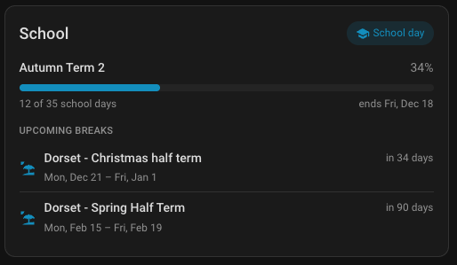

# Family Today for Home Assistant

[](https://github.com/th0mashoward/ha_family_today/actions/workflows/validate.yml)
[](https://github.com/th0mashoward/ha_family_today/releases)
[](LICENSE)
[](https://github.com/hacs/integration)

[](https://my.home-assistant.io/redirect/hacs_repository/?owner=th0mashoward&repository=ha_family_today&category=integration)

One merged "today" view across your calendars: a per-person agenda, a school
day flag, bin collections (from a [Waste Collection Schedule] calendar or manual
rules), and bundled Lovelace cards for the day and for school terms.

<!-- Screenshots: save PNGs as assets/screenshots/day-card.png and
     assets/screenshots/school-card.png, then delete the surrounding comment.
     Absolute URLs are used so the images also render on the HACS store page.

## Screenshots

| Day card | School card |
| :---: | :---: |
|  |  |
-->

## Install

The button above opens this repository inside HACS. It only works once the
repository has been added, so for a first install:

### HACS (custom repository)
1. HACS > ⋮ > **Custom repositories**.
2. Add `https://github.com/th0mashoward/ha_family_today`, category **Integration**.
3. Download **Family Today**, then restart Home Assistant.
4. Settings > Devices & services > **Add integration** > Family Today.
5. Pick your calendars and name their owners. Use **Configure** for school terms and bins.
6. Add the card (hard-reload the browser the first time). Click an event to see
   its details, including the description, time, location and person:

```yaml
type: custom:family-today-card
layout: lanes      # or "list" (default)
hide_past: true    # optional
colors:            # optional
  Tom: "#4285f4"
```

For a school-focused view there is a second card with term progress (counted in
actual school days), back-to-school countdowns and a timeline of upcoming
holidays and INSET days. It shows one section per child when per-child school
calendars are configured:

```yaml
type: custom:family-today-school-card
title: School          # optional
max_breaks: 3          # optional, 1-6
```

To run more than one view (for example a second dashboard or another household),
add the integration again with a different **Name**. Each instance gets its own
device, entities and calendar settings.

### Manual install
Copy `custom_components/family_today` into your HA `config/custom_components/` and restart.

## Entities
- `sensor.family_today_today`: event count; attributes `agenda`, `by_person`, `people`, `next_event`, `school_day`, `term`, `break_reason`, `school`, `school_by_person`, `school_overrides`, `school_source`, `bin_source` (calendar or manual/rules), `bins_today`, `bins_tomorrow`, `bin_meta`, `calendar_status`, `calendars_ok`, `calendars_total`
- `sensor.family_today_next_bin_collection`
- `binary_sensor.family_today_school_day`
- `binary_sensor.family_today_<child>_school_day` (one per child with a school override)
- `binary_sensor.family_today_bins_out_tonight`

### School badge
Click the school badge on the card for the detail behind it: the reason when
there's no school (`Half term`, `INSET day`, `Weekend`, or the calendar event's
own title), the current term, term end, next break, next term and back-to-school
dates with day counts. When per-child school calendars are configured, the card
shows a badge per child and each one opens that child's details. The same data
is available to templates as `break_reason`, a `school` attribute and a
`school_by_person` mapping (ISO dates + `days_until_*` numbers) on the sensors
above. The `school` object also carries `term_start`, `term_progress` (actual
school days done), `term_school_days`, `term_school_days_done` and
`upcoming_breaks` (name, start/end, length, days until and kind) for the
`family-today-school-card`.

### Reliability
- Calendars are fetched concurrently, each with a 20 second timeout, so one slow
  or broken feed doesn't hold up the rest.
- School feeds are also read 200 days back, so term progress can count actual
  school days across the current term (not calendar days).
- A failed calendar keeps **today's** last good events (never yesterday's). Bins
  and school dates keep their last good fetch until the source recovers.
- The card shows a muted **Showing saved events** or **Calendar unavailable**
  banner naming the affected calendars.
- After 3 consecutive failures a **Repairs** issue appears with the last error;
  it clears automatically on the next successful fetch.
- Long event descriptions are truncated at 1000 characters so attributes stay
  comfortably inside Home Assistant's state-size limit.
- Settings > Devices & services > Family Today > **Download diagnostics** gives
  the options, per-calendar health and today's summary (personal names redacted).

## Configuration (Configure button)
- **School calendar (optional):** pick a calendar entity, e.g. an ICS feed of school
  dates. It is treated as a list of **days off**: events whose title contains a
  *break keyword* (default `holiday`, `half term`, `inset`, `closed`, `break`...)
  make those days non-school days. Multi-day seasonal events named just
  `Easter`, `Christmas`, `Summer` or `Autumn` (as SchoolHolidays.org.uk feeds do)
  also count as breaks; a single `Summer Fair` does not. Every other configured
  school weekday is a school day; weekends and the manual INSET dates are always
  off. Term-span events (title contains a *term keyword*, default `term`) name
  the current term, and single-day "term starts" / "term ends" markers are
  ignored. With a holiday-only feed, terms are inferred from the gaps between
  half terms and longer breaks and named `Autumn Term 2`, `Spring Term 1`, etc.
  Gaps between terms are *not* assumed to be holidays: the feed must mark
  holidays with a break keyword or a seasonal name. If the calendar can't be
  read, the manual terms below are the fallback.
- **Per-child school calendars:** use **Configure > School terms > Per-child
  school calendar** to give a child their own school feed and optional keyword
  overrides. This is for siblings at different schools with different INSET days
  or term dates. Weekdays, manual terms and INSET days stay shared; a child with
  no override uses the shared settings. Each override also adds a
  `<child> school day` binary sensor.
- **Manual terms (fallback):** one per line, `2026-11-02 to 2026-12-18 Autumn 2`; INSET days as dates
  (INSET days listed here apply on top of a school calendar too).
- **Bins:** pick a Waste Collection Schedule calendar, rename titles with
  `Refuse = General waste`, or use manual rules `General waste | thu | 2 | 2026-11-12`
  and holiday moves `2026-12-24 -> 2026-12-23` (or `-> skip`).
- **Bin colours/icons:** one per line, `General waste | grey | mdi:trash-can`.
  Colour and icon are both optional, and names match the *displayed* name (so
  aliases apply). Colours can be a name (`grey`, `blue`...), `#hex`, `rgb()` or
  `hsl()`. Icons default from the name (`recycling` → recycle, `garden` → leaf,
  `food` → apple...). The card uses them for the bin banners; other templates can
  read the `bin_meta` attribute of `sensor.family_today_today`, the next-bin
  sensor and the bins-out binary sensor.

## Development
- Python logic tests: `python3 tests/test_schedule.py && python3 tests/test_parsing.py && python3 tests/test_sources.py`
- Card: `cd frontend && npm install && npm run build && npm test`
  (writes `custom_components/family_today/www/family-today-card.js`, which is committed because HACS doesn't build)
- Brand icon: `python3 assets/make_icon.py`
  (writes `custom_components/family_today/brand/icon.png` and `icon@2x.png`; HA 2026.3+ picks these up automatically)
- Release: set `version` in `custom_components/family_today/manifest.json` and tag
  the release with the same version prefixed with `v` (e.g. `v0.2.2`). HACS offers
  the release tag while Home Assistant shows the manifest version, so keep them in
  sync. The card cache-buster is read from the manifest automatically.

Status: early (0.1.1). The pure logic and card have unit/smoke tests, and it is
running on a live Home Assistant instance.

[Waste Collection Schedule]: https://github.com/mampfes/hacs_waste_collection_schedule
